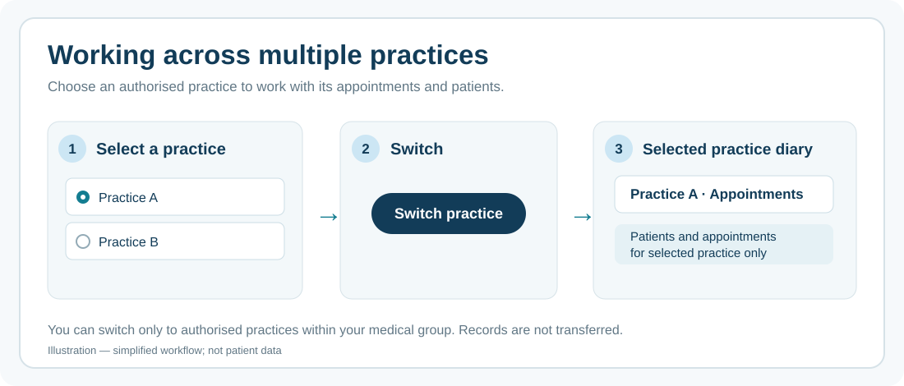
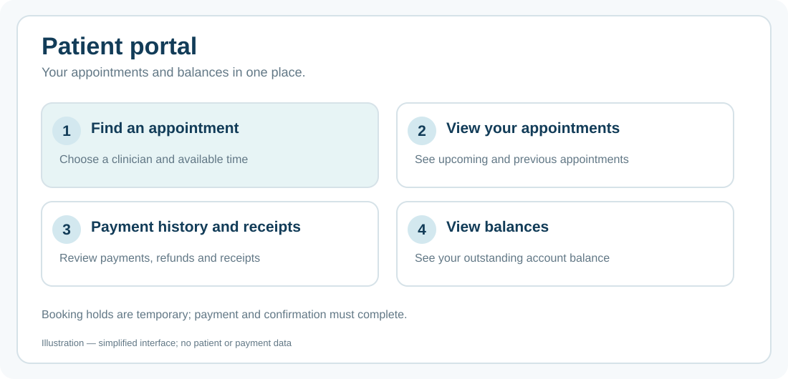
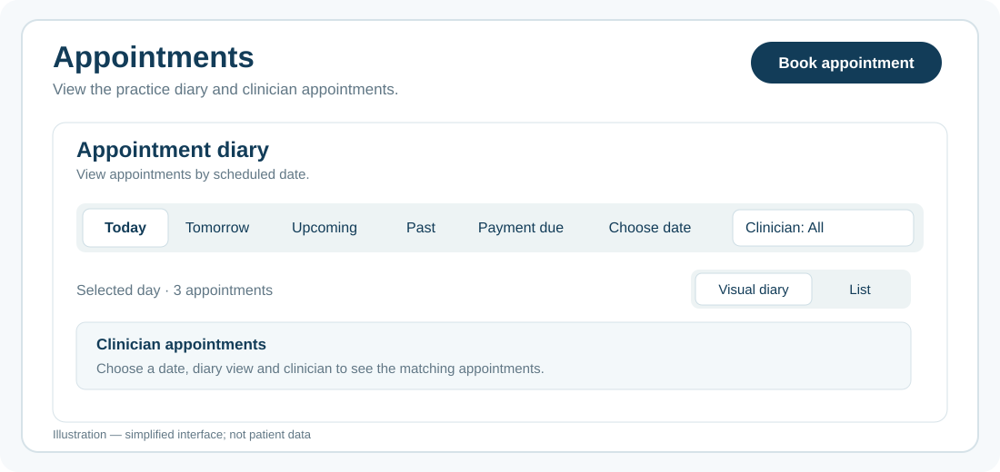
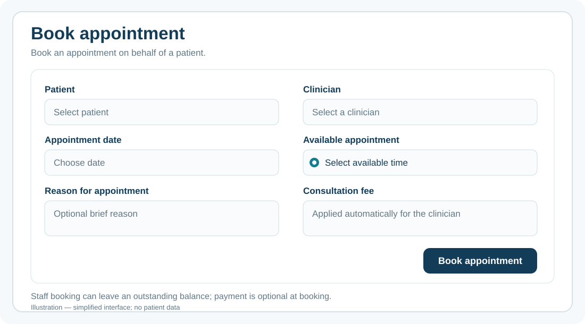
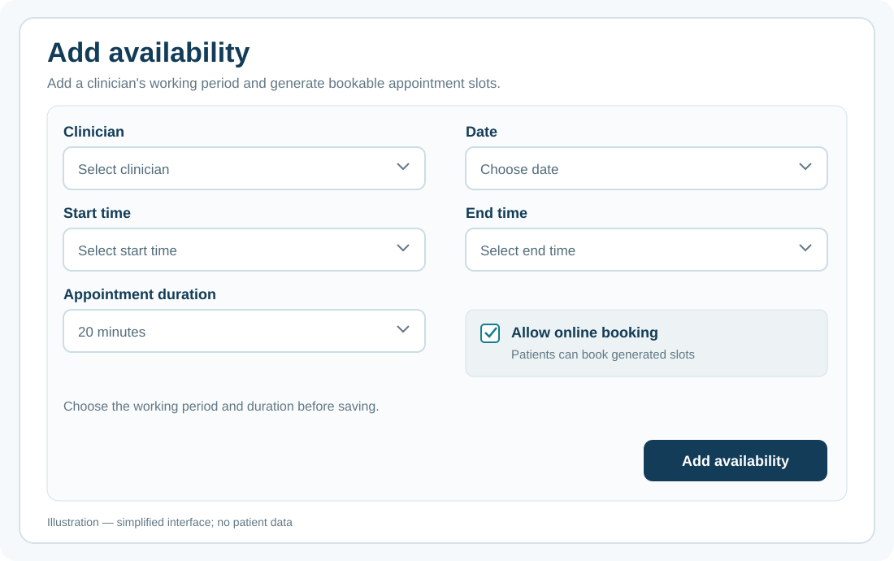
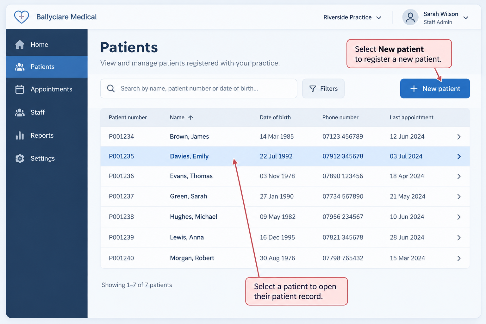
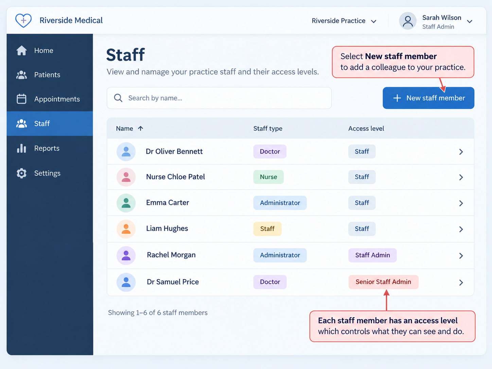
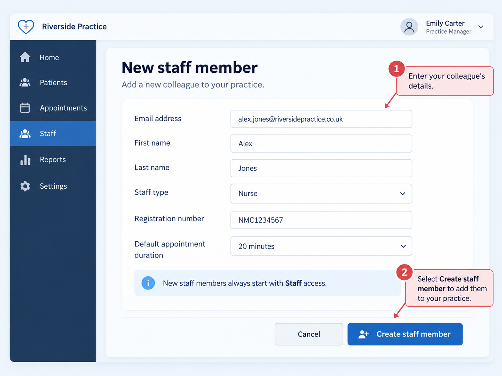
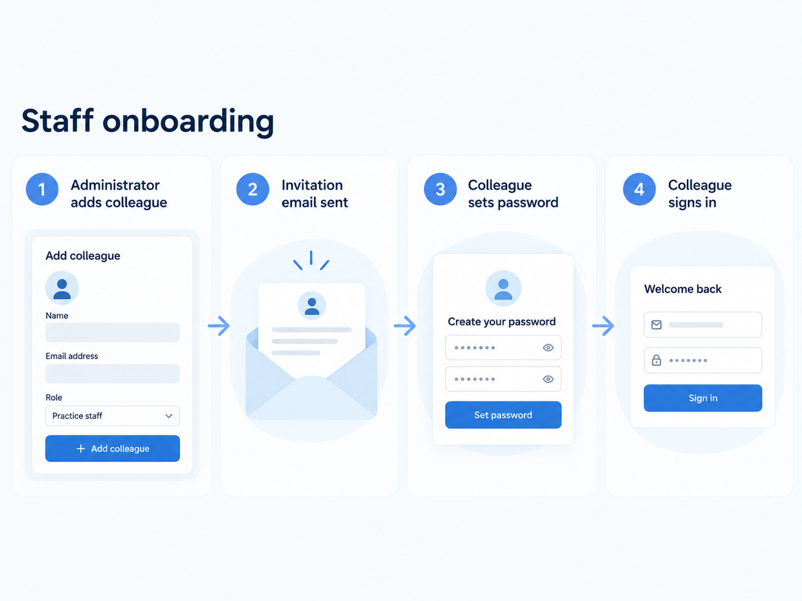

# Ballyclare Medical User Manual

This guide is intended for reception, administrative and clinical staff using
Ballyclare Medical. It is being expanded as new features become available.

## Contents

- [Getting Started](#getting-started)
- [Signing In](#signing-in)
- [Working Across Multiple Practices](#working-across-multiple-practices)
- [Patients](#patients)
- [Patient Portal: Registration and Access](#patient-portal-registration-and-access)
- [Patient Portal: Appointments and Payments](#patient-portal-appointments-and-payments)
- [Patient Portal: Appointment Changes](#patient-portal-appointment-changes)
- [Patient Portal: Profile Management](#patient-portal-profile-management)
- [Appointment Diary](#appointment-diary)
- [Booking an Appointment](#booking-an-appointment)
- [Cancelling an Appointment](#cancelling-an-appointment)
- [Payments and Refunds](#payments-and-refunds)
- [Stripe Booking Payment Reconciliation](#stripe-booking-payment-reconciliation)
- [Clinical Consultations and Patient Documents](#clinical-consultations-and-patient-documents)
- [Clinician Availability](#clinician-availability)
- [User and Staff Administration](#user-and-staff-administration)
- [Troubleshooting](#troubleshooting)

## Getting Started

Ballyclare Medical supports day-to-day practice operations, including patients,
clinician availability, appointments and payments. Some clinical and
administrative features are still under development.

## Signing In

Sign in using your individual staff account and password. New staff
members receive password-setting instructions when an administrator
creates their account, provided outgoing email is configured. If you
cannot remember your password, use **Forgot password?** on the sign-in
page. Never share account credentials.

## Working Across Multiple Practices

A medical group can contain multiple practices. Each practice retains its own
patients, appointment slots, appointments, payments and clinical records.

### Selecting a working practice

*Practice switching: Select an authorised practice, switch, and work with that
practice's appointment diary and patient records.*

If your medical group contains more than one practice, the staff interface
shows a practice selector. Choose the location you want to work with; the
application switches to that practice's appointment diary. The selected
practice determines which practice's patient and appointment records are
displayed in staff workflows.

You can only switch to practices in your authorised medical group. A practice
in a different group cannot be selected through the staff interface. If a
previously selected practice is no longer authorised, the application falls
back to your home practice.

### Staff roles and clinician diaries

Staff can use their account to switch between practices in the same medical
group, subject to their active staff status and role. If you have a separate
active staff membership at the selected practice, its role and clinician
identity apply there.

- **Administrators:** Can manage permitted operational workflows for the
  selected practice. This does not grant access to another medical group.
- **Clinicians:** Appointment diaries and availability remain restricted to
  the clinician's own records. If you have no local clinician membership,
  the selected practice's diary does not reveal other clinicians' appointments.
- **Other staff:** Available actions depend on the access level assigned to
  your active staff membership.

### Patient records and bookings

Patient searches, appointment bookings and appointment details remain scoped
to the **selected practice**. Switching practices does not transfer patients,
slots or appointments between locations. To book at another practice, first
select that practice and use a patient record and available slot belonging
to that location.

Patient portal identity verification and account approvals remain
practice-specific.

### Clinical confidentiality

Clinical encounters and notes must refer to patients and clinicians associated
with the correct practice. The application validates these relationships.
Clinical consultations and clinical notes are accessible only to the assigned, active clinician in the selected practice. Practice switching does not grant access to clinical notes.

If you cannot see an expected appointment or availability record, check the
selected practice and your assigned role. Contact a practice administrator
rather than attempting to access records through another location.

## Patients

Authorised operational staff can open **Patients** to search or browse
records for their own practice, register a new patient, and view or edit
existing patient details. When a practice administrator registers a patient,
they can optionally tick **Send a portal invitation** and enter the patient's
email address in the same form. This uses the existing patient account request
workflow; it does not grant portal access. See [Patient records](#patient-records) below
for the registration fields and illustrated instructions.

## Patient Portal: Registration and Access

Patients can create a separate online patient account at **/patients/sign_up**,
confirm their email address and sign in at **/patients/sign_in**. Confirming an
email address does not verify the patient's identity or grant access to a
clinical record. Practice staff must verify identity and approve the account
connection through the patient account request workflow before patient-specific
appointment, payment or profile information becomes available.

Practice administrators can also open an existing patient record and select
**Invite to patient portal**. An invitation creates an unapproved patient account
request and sends a single **Activate your patient portal** email containing
a **Confirm email address and set password** action. Clicking it confirms the
email address and opens the password-setting form. The patient must choose
their own password. Invitations
appear under **Patient accounts**, including those awaiting email confirmation.
The practice must still verify the patient's identity, select the correct
existing patient record and obtain senior administrator approval. Never create
an additional patient record just to provide portal access.

Practice administrators review patient account requests and verify the
correct practice and patient record. Never approve an account based on an
email-address match alone. If access is pending or revoked, the portal
displays an access-unavailable message; the patient should contact the
practice. Staff must use the authorised approval or reinstatement process.

Patients without a portal account can still have practice records and
staff-booked appointments. Guest booking is a separate workflow.

## Patient Portal: Appointments and Payments

*Patient portal: Use the dashboard to find an appointment, view existing
appointments, review payment history and receipts, or check outstanding balances.*

### Viewing appointments

After signing in with an approved patient account, open **View your appointments**
to see upcoming appointments and past or cancelled appointments. The history
includes completed and cancelled bookings where applicable. Appointment details
are limited to the patient record approved for your account at that practice.

If the portal reports that access is unavailable, contact the practice to
check the identity-verification and account-approval process. Do not create
a second account to bypass an outstanding approval.

### Booking online

The authenticated patient portal provides online appointment selection and
payment. An available time may be held temporarily while payment is completed;
a hold alone is **not** a confirmed appointment. Follow the payment and
confirmation screens, and check the appointment list for the final booking
result. If payment status is uncertain, do not repeatedly submit payment;
contact the practice for assistance.

Public guest booking at **/book** is separate from the authenticated portal.

### Payment history and receipts

Open **Payment history and receipts** in the patient portal to review recorded payments,
their status and associated refunds. A receipt is available for a payment
recorded as successful. A pending or processing payment is not proof that
the payment has succeeded, and a requested refund is not necessarily complete.

### Paying an outstanding balance

For an appointment with an outstanding balance, use its **outstanding payment**
option in the patient portal to review the amount and proceed to secure payment.
The amount is calculated from the appointment's recorded charges, payments
and refunds. If a payment is already being processed, wait for its result
rather than attempting another payment. If secure payments are temporarily
unavailable, try again later or contact the practice.

## Patient Portal: Appointment Changes

### Cancelling an appointment (P2.1)

1. Sign in to the patient portal and open **View your appointments**.
2. Find an upcoming **Booked** or **Confirmed** appointment.
3. If its start time is at least **24 hours away**, select **Cancel appointment**
   and confirm the action.
4. Return to appointment history. The appointment moves from **Upcoming appointments**
   to **Past and cancelled appointments**, where it is marked **Cancelled**.

Cancellation is unavailable within 24 hours of the appointment start,
after the appointment has started, or for an appointment in an ineligible
status. Patients cannot cancel another patient's appointment. Contact the
practice if the cancellation control is unavailable.

On successful cancellation, the active consultation charge is voided.
Eligible successful payments trigger an automatic refund request; the
refund may take additional time to be confirmed by Stripe. The payment
and refund records remain in the financial history. A pending or
processing payment blocks cancellation until its outcome is known.
The patient portal initially confirms that an eligible refund has been
requested. Under **Past and cancelled appointments**, paid cancellations
show the latest recorded refund outcome: **Refund pending**, **Refund
completed**, or **Refund failed — contact your practice**. The status
updates automatically while the appointment-history page is open; if the
live connection is interrupted, refresh the page to retrieve the latest
recorded status.

**Do not assume a refund has completed merely because cancellation succeeded.**
See [Payments and Refunds](#payments-and-refunds).

### Rescheduling an appointment (P2.2)

1. From **View your appointments**, select **Reschedule** for an upcoming
   booked or confirmed appointment at least **24 hours** before it starts.
2. Choose a replacement appointment from the date-grouped available-time
   cards. Each card identifies the time and clinician.
3. Submit the change and check the updated appointment history.

Patients may choose a different clinician only when the replacement
clinician is the **same type** as the original (doctor to doctor or nurse
to nurse). To switch between doctor and nurse, cancel and make a new
booking instead, subject to the cancellation policy. Patient choices are
limited to future online-bookable availability in the same practice.
The system checks the replacement slot again at submission: a slot
booked or held by someone else is rejected.

Rescheduling retains the existing appointment, charges and successful
payments; it does not silently change the fee or issue a refund. It
records an audit event identifying the original and replacement slots,
clinicians, times and initiating actor. A pending or processing payment
must reach a final state before rescheduling.

### Staff rescheduling and overrides

Authorised operational staff can open an eligible appointment in the
practice and use **Reschedule**. Staff can override the patient's
24-hour notice restriction, including on the same day, **but cannot
reschedule an appointment after its original start time**. Same-day
rescheduling is allowed only while the original appointment has not started
and the replacement slot is still in the future. The original
appointment must still be booked or confirmed. The replacement must be
future, available, within the same practice and with the same clinician
type. Staff Clinicians are restricted to their own appointments; Basic
Staff cannot reschedule. Staff may use available slots that are not
online-bookable. The same financial integrity and audit rules apply.

## Patient Portal: Profile Management

Patients with an approved connection can open **Your profile** on the
patient portal dashboard. The profile shows the verified name, date of
birth and patient number alongside the sign-in email address.

Select **Edit sign-in details** to change the email address or password.
Enter the **current password** to save changes. To keep the existing
password, leave both new-password fields blank. When changing the
password, enter matching new-password and confirmation values.
An email-address change requires confirmation through the new inbox
before the new sign-in address becomes active.

Verified identity details (name, date of birth and patient number)
cannot be edited through the portal. Patients should contact the
practice for corrections so staff can verify the request and update
the patient record using the authorised workflow. A revoked or
unapproved connection cannot view or update the profile.

## Appointment Diary

*Appointment diary: Choose a date or view, filter by clinician where permitted,
and switch between visual and list layouts for a selected day.*

Open **Appointments** to view the selected practice's diary. Use **Today**,
**Tomorrow**, **Upcoming**, **Past** or **Payment due** to choose a diary
view. Select **Choose date** to display a specific day. On a day view,
switch between **Visual diary** and **List**. Where available, choose a
**Clinician** and select **Apply** to filter the diary. Select an
appointment to review its patient, clinician, status, financial details and
available actions. Check the selected practice before searching for an
appointment: switching practices changes which diary is displayed.

All active staff can view the appointment diary and permitted appointment
details. Basic Staff have read-only access: they cannot book appointments,
change appointment statuses, manage patients or availability, or take payments.
Staff Admins, Staff Clinicians and Senior Staff Admins can perform permitted
operational tasks. Staff Clinicians see only appointments assigned to their
own active clinician membership at the selected practice; they cannot open
another clinician's appointment details by using its URL.

### Changing appointment status

Open an appointment and use the available status controls. The application
shows only permitted transitions and records changes in the appointment
activity history. A pending or processing payment can prevent certain changes;
wait for its outcome to be confirmed before retrying. Do not mark a
consultation complete unless the required clinical workflow has actually
taken place; the clinician consultation workspace is still planned for Phase 6.

## Booking an Appointment

*Staff appointment booking: Select the patient, clinician, date and available
time, then review the consultation fee before confirming the booking.*

Staff Admins, Staff Clinicians and Senior Staff Admins can book appointments
on behalf of patients. Basic Staff can view the diary but cannot book.

1. Open **Appointments** and select **Book appointment**.
2. In the **Patient** field, start with **Select patient**. Click the field
   to see up to five patients, or type a name or patient number to search.
   Choose the correct matching patient from the results. Use the up/down
   arrow keys and **Enter** to choose a result, or **Escape** to close the
   suggestions. The search only returns patients in your practice.
3. Select a **Clinician** (doctor or nurse).
4. Choose the **Appointment date**. Available appointments for that
   clinician and date appear below.
5. Select an available appointment time.
6. Optionally enter the **Reason for appointment**.
7. Review the **Consultation fee** on the booking form. Practice administrators
   configure fees by clinician type; the relevant price is applied automatically.
8. Select **Book appointment**. The system creates the appointment and
   its initial charge, then opens the appointment details.

**Payment is optional for staff-assisted bookings.** The appointment can
remain booked with an outstanding balance. Authorised staff may then take
payment from the appointment page; a failed optional payment does not undo
the already-created appointment.

If the chosen time has become unavailable, choose another available slot.
The server checks availability again when the booking is submitted.

The authenticated patient portal supports patient booking with temporary appointment
holds and payment before confirmation. This is separate from staff-assisted
booking, where payment at booking is optional. Public guest booking at
**/book** is a separate workflow.

## Cancelling an Appointment

Open the appointment and use the available status controls to cancel it.
Cancellation is blocked while a payment is pending or processing; wait for
the payment to reach a final state before trying again.

When cancellation succeeds, any active consultation charge is voided.
The original charge remains in the appointment's financial history.

If a successful payment has been collected, the system also requests a
refund for the amount not already covered by completed or in-progress
refunds. Staff do not need to initiate the standard cancellation refund
separately.

## Payments and Refunds

### Viewing payments and charges

The appointment page shows a financial summary with:

- **Charges** — total active charges, excluding voided charges.
- **Payments** — successful payments received.
- **Refunds** — refunds confirmed as successful.
- **Outstanding balance** — charges minus successful payments plus
  successful refunds.

A negative outstanding balance can appear temporarily after a paid
appointment is cancelled and its charge is voided, before the refund
has been confirmed. It should return to zero after a full refund succeeds.

Charges and refund records remain available for financial history and
audit purposes; voiding a charge does not delete it.

### Refund status messages

The appointment page may display one or more refund messages:

- **Refund pending** — the refund has been requested and is awaiting
  processing.
- **Refund processing** — the refund is being processed by Stripe.
- **Refund completed** — Stripe has confirmed the refund succeeded.
- **Refund failed** — the refund could not be completed and needs staff
  attention.

There may be more than one refund record for an appointment, such as
when a partial refund has already been made or an earlier refund attempt
failed. Read all status messages before taking further action.

### Automatic updates

While the staff appointment page is open, refund status messages and
the financial summary update automatically when the system receives
refund status changes. Staff normally do not need to refresh the page.

If the connection is interrupted or the page has been closed, reopening
or refreshing the appointment will display the latest recorded state.

### When a refund fails

A red **Refund failed** message indicates **Staff attention required**.
Review the appointment's payment and refund history and follow the
practice's escalation procedure. Do not assume the patient has been
refunded, and do not initiate a second refund without checking the
existing payment and refund records.

The staff interface currently shows refund status, but it does not
provide a manual refund initiation or retry control. Failed refunds
are not automatically retried.

### Online booking payment exceptions

If Stripe collects payment but an online appointment cannot be created
(for example, because its hold expired), the payment can be marked
`requires_refund`. Payment and refund history is retained separately
from appointment records in this case.

## Stripe Booking Payment Reconciliation

**For Staff Admins and Senior Staff Admins.** Open **Booking payment reconciliation** from the practice navigation, or visit `/practice/booking_payment_reconciliations`. This is an administrative review queue for unresolved **online Stripe booking payments**, not a tool for taking a new payment or issuing a refund.

### When a payment appears

The queue shows Stripe payments associated with your practice that have been **pending** or **processing** for at least 15 minutes and do not yet have an appointment attached. It also shows locally **failed** booking payments with a recorded Stripe PaymentIntent after the appointment hold has expired, where Stripe cancellation has not yet been confirmed through this review workflow. A local failure does **not** prove that the Stripe PaymentIntent is cancelled. The queue is limited to the 100 oldest matching payments.

**Do not assume that an unresolved payment means the patient has not been charged.** Before starting any replacement booking or payment attempt, investigate the existing payment outcome. A Stripe timeout or unavailable verification is not grounds for creating an unpaid appointment.

### Finding and verifying a payment

1. Search by **patient name**, **guest name**, **payment reference** or **Stripe PaymentIntent ID**. The search is limited to payments for your practice.
2. Check the matching payment reference, patient or booking details and local payment status.
3. Review the PaymentIntent in the **correct Stripe account and mode** (live or test, as appropriate). Check the payment outcome and transaction details.
4. In the **Stripe PaymentIntent ID** field, confirm the correct `pi_...` reference and select **Verify payment with Stripe**.
5. Read the result and the **Stripe status (last checked)** column. Its timestamp refers to the **last audited verification**, not a continuously live Stripe status. Verify again if you need a fresh result.

Verification checks the PaymentIntent against the local payment and records an audit event. **It does not create a new charge.** A confirmed successful payment may be recovered and reconciled with its booking; otherwise the payment remains unresolved until the appropriate next action is clear. Search and verification results update on the page without a full reload.

### Cancelling an abandoned payment

Use **Cancel abandoned payment** only when the original payment attempt is genuinely abandoned and you have checked the PaymentIntent in Stripe. Cancellation prevents further payment attempts using that PaymentIntent and cannot be undone. **It does not refund a successful payment.**

1. Confirm the payment reference and PaymentIntent ID match the intended booking attempt.
2. Confirm in Stripe that the PaymentIntent has **not succeeded** and is eligible for cancellation.
3. Select **Cancel abandoned payment**.
4. Read the confirmation dialog carefully and verify the exact PaymentIntent ID before continuing.
5. Check the success message and the Stripe Dashboard. When cancellation is confirmed and the local outcome is reconciled, the payment disappears from the unresolved queue.

The application also checks Stripe status, metadata, amount and currency before permitting cancellation. Locally failed booking payments can only be cancelled through this workflow **after their hold has expired**; pending and processing payments retain their existing eligibility rules. If the check or cancellation cannot be confirmed, the payment remains available for investigation; do not assume it was cancelled. If Stripe was already cancelled, use **Verify payment with Stripe** to record that outcome and remove the failed item from the review queue without issuing another cancellation.

### If Stripe is unavailable or the outcome is uncertain

- Leave the payment unresolved and escalate according to your practice's payment investigation procedure.
- **Do not repeat the charge**, create an emergency unpaid booking for the same existing payment attempt, or repeatedly press cancellation hoping for a different result.
- Check the original PaymentIntent, any associated charge, and the local audit history before taking further action.
- If a successful payment is discovered but no valid appointment can be created, use the established payment/refund investigation process rather than booking the appointment manually.
- For failed or uncertain **refunds**, follow [Payments and Refunds](#payments-and-refunds); this reconciliation queue is not a refund retry facility.

Only suitably authorised administrators can perform these actions, and reconciliation results are recorded for audit purposes.

## Clinician Availability

*Clinician availability: Choose the clinician, date, start and end times,
appointment duration and whether patients may book the generated slots online.*

Open **Availability** in the selected practice to review upcoming availability
blocks. Select **Add availability** to choose a clinician, date, start and end
times, slot duration and whether the slots are bookable online. Save the block
to generate appointment slots for staff booking. Times are entered in the
selected practice's configured timezone.

To change an existing block, select its edit action, update the details and
save. To remove future availability, use its cancel action. Changes may be
refused when they conflict with existing availability, appointments or active
booking holds; read the displayed error before making a new selection.

**Allow online booking** controls whether the availability is offered for online
booking. Staff booking can use otherwise eligible slots that are not offered
online.

Staff Clinicians can view, create, edit and cancel only their own availability
at the selected practice. Staff Admins and Senior Staff Admins can manage
availability across that practice. Basic Staff cannot manage availability.
If a clinician has no active local membership at a selected practice, they
cannot manage another clinician's availability there.

## User and Staff Administration

### Patient records

*Patients list: View patients registered with your practice, open an existing
patient record or begin a new registration.*

Staff can open **Patients** from the practice navigation to view patients
registered with their practice. Select **New patient** to register a patient,
entering first name, last name and date of birth; the patient number is generated automatically.
Select a patient from the list to view or edit their details. Patient records
from other practices are not available through these pages.

*New patient: Enter the patient number, first name, last name and date of
birth, then save the new patient record.*

### Staff directory and access levels

*Staff directory: View colleagues linked to your practice. Staff type describes
their responsibilities; access level determines their administrative permissions.*

The staff directory is currently available at `/practice/staff_members`.
It lists staff members associated with the **currently selected practice**.

A staff member's type (doctor, nurse or administrator) describes their
responsibilities. Their *access level* separately determines administrative
authority within that practice:

- **Staff** — the default level for every new staff membership; can view the
  appointment diary and staff directory, but cannot make operational changes.
- **Staff Clinician** — available to doctors and nurses; can manage appointments,
  patients and payments, but only their own availability. Additional access to
  medical records is planned but has not yet been enabled.
- **Staff Admin** — can manage operational work and ordinary staff accounts,
  but cannot change access levels or administer privileged staff accounts.
- **Senior Staff Admin** — has full operational access and can change access
  levels for staff in their own practice.

Only Senior Staff Admins may change another staff member's access level.
To do so, open **Staff**, select **Edit access** beside a colleague, choose
the appropriate level and select **Save access level**. Select **Cancel**
to leave their access unchanged. Staff Clinician is available only for
colleagues whose staff type is Doctor or Nurse.

The server rejects requests from ordinary Staff and Staff Admin accounts,
as well as requests affecting staff in a different practice. Senior Staff
Admins cannot demote themselves. A staff member's access level in one
practice does not confer those permissions in another.

### Adding a staff member

*New staff member: Enter your colleague's email address and practice details,
then select Create staff member.*

Staff Admins and Senior Staff Admins can add colleagues to their practice.
Open the staff directory at `/practice/staff_members` and select
**New staff member**. Enter the colleague's email address, name, staff type
(doctor, nurse or administrator), and any applicable registration number. First name and last name are required.
The form highlights missing required fields. Then select **Create staff member**.

New colleagues always start with **Staff** access. A Senior Staff Admin must
approve any subsequent change to their access level.

If the email address is new to Ballyclare Medical, the system creates an
account and sends a **Welcome to Ballyclare Medical** email to that address.
The colleague selects **Set your password**, enters and confirms a new
password, and selects **Set my password**. After successful setup, the
application signs them in and redirects to the home page.
If an account already exists, it is linked to the practice without changing
the person's existing password or sending another password-setting email.

*Staff onboarding: An administrator adds a colleague, the new colleague
receives password-setting instructions, chooses a password and signs in.
Existing account holders continue using their current password.*

If an error appears, correct the details and try again. An existing staff
member cannot be added to the same practice twice.

**Invitation links:** Password setup links expire and cannot be reused after
successful password setup. If a link has expired, use the **Forgot password?**
option on the sign-in page or contact your practice administrator for help.

**Email availability:** Sending invitations requires the platform operator
to configure the application's outgoing email service. If an expected
message does not arrive, ask the platform operator to check email delivery;
do not share passwords or create a duplicate account.

### Editing staff details

From the staff directory, select **Edit details** beside a colleague to
change their first name, last name, registration number or staff type.
The email address is displayed for reference but cannot be edited here.
First and last names are required. Select **Save changes** to apply updates,
or **Cancel** to return without saving. Access levels are managed separately
through **Edit access** by a Senior Staff Admin.

### Deactivating and reactivating staff

Authorised administrators can select **Deactivate** beside an active staff
member in the staff directory and confirm the action. The application blocks
deactivation of a clinician with future non-cancelled appointments; review
and resolve those appointments first. It also protects the last active
Senior Staff Admin from deactivation. The colleague remains
listed with an **Inactive** badge and a **Reactivate** action. Deactivation
blocks their access to protected practice pages without deleting their
staff record or appointment history.

If an inactive staff member tries to sign in with their correct email and
password, the sign-in page displays **Your staff account is inactive** and
asks them to contact their practice administrator. Incorrect credentials
still receive the normal sign-in error; account status is not disclosed
before password verification.

If a staff member was already signed in when deactivated, opening a
protected practice page displays an account-inactive message with a
**Sign out** button rather than a blank page. Select **Sign out** to end
the session. An administrator can select **Reactivate** in the staff
directory to restore practice access. Reactivation does not require a
new invitation or password.

### Setting up the first Senior Staff Admin

When a new practice is added, an authorised platform operator sets up its
first Senior Staff Admin. The practice should provide the intended
administrator's email address and confirm who is authorised to manage
staff access.

The initial setup is not yet available through the staff interface.
Contact the platform operator to arrange it; practice staff do not need
to use a terminal or Rails console. Once setup is complete, the
administrator can sign in using their own account.

A practice can only go through this initial setup before any staff
members have been registered. If the practice already has staff, contact
the platform operator rather than trying to repeat the setup.

The initial Senior Staff Admin setup is a separate operator process; the
ordinary staff invitation form cannot grant senior permissions.
Never share passwords or use a shared administrator login.

### Recovering administrative access

If a practice has existing staff but no accessible Senior Staff Admin,
**do not rerun bootstrap or create a substitute privileged account using
seed data**. Escalate to an authorised platform operator to verify the
practice and account ownership before recovery. A dedicated, audited
recovery workflow has not yet been implemented.

Do not deactivate the last active Senior Staff Admin. If senior access is
lost, contact an authorised platform operator for recovery.

## Troubleshooting

**Clinical document not visible in the patient portal:** Confirm that the clinician completed and signed the consultation, separately released a patient-facing document, and that the patient account has an approved connection to the correct practice and patient record. Internal notes are never published automatically.

**Cannot start or sign a consultation:** Check that the patient is marked Arrived, the appointment belongs to the signed-in clinician in the selected practice, and the draft is saved before signing. An administrator cannot sign on a clinician’s behalf.

**Patient cannot access appointment history or profile:** Confirm that the patient has verified their email and that an authorised practice administrator has approved the correct account-to-patient connection. If access was revoked, follow the practice's reinstatement process. Do not bypass verification.

**Cancel or reschedule option missing:** Check that the appointment is booked or confirmed and starts at least 24 hours from now. Patients cannot override this cutoff; contact the practice for assistance. Staff may reschedule before the original start under their own permissions.

**Replacement slot no longer available:** Another appointment or active hold may have taken the slot. Return to the rescheduling page and choose a different available slot. A doctor-to-nurse or nurse-to-doctor change requires cancellation and a new booking.

**Cancelled appointment or refund missing from upcoming list:** Cancelled
appointments appear under **Past and cancelled appointments**, not
**Upcoming appointments**. A refund may first show as pending before
changing to completed. If the status does not update, refresh the
appointment-history page; for a failed refund, contact the practice.

**Payment prevents appointment changes:** Wait for a pending or processing payment to settle. Check the existing payment before attempting another transaction or booking.

**Profile email change not reflected:** Open the confirmation email sent to the new address. Until confirmation, the existing email remains the sign-in address. Check junk mail and ask the platform operator to investigate email delivery if necessary.

**Profile update rejected:** Confirm the current password and ensure the new password and confirmation match. For verified name or date-of-birth corrections, contact the practice rather than changing the online account.

**Cannot find a patient when booking:** Search by first name, surname or
patient number. Only the first five matching results appear; type more of
the name or number to narrow the list. If the patient has not yet been
registered with your practice, an authorised staff member can add them
through **Patients → New patient**.

**Appointment time disappears or cannot be booked:** Another booking or
temporary hold may have taken the slot. Choose another available time.
Do not repeatedly submit the same appointment if a confirmation has
already appeared; check the diary first.

**Cannot sign in after deactivation:** If the account-inactive message
appears after entering the correct password, contact your practice
administrator. Resetting the password does not reactivate staff access.

**Invitation email not received:** Check your inbox and junk folder. If
email delivery is not configured, contact the platform operator.

**Password setup link expired:** Use **Forgot password?** from the sign-in
page to request a new password link.

If an appointment's refund does not update immediately, check the
current refund status and allow time for Stripe processing. Refresh the
appointment page if the live connection has been interrupted.

For a failed refund, follow the escalation guidance above rather than
repeatedly attempting payment or cancellation actions.

## Clinical Consultations and Patient Documents

This workflow is for an **assigned, active doctor or nurse** with local
`staff_clinician` access. Staff administrators cannot read clinical notes
merely because they can manage appointments. Practice selection does not
override clinician assignment or patient-record isolation.

### 1. Open an assigned appointment

In the practice workspace, open **Appointments** and select the patient's
appointment. Confirm the patient's name, patient number, clinician, date and
appointment reason. Select **Open consultation**. This action is visible only
to the assigned clinician with the required access level.

The **Consultation** page shows **Appointment and patient**, **Consultation
record**, and **Previous clinical encounters**. Previous encounters are
restricted to the current practice; only signed historical notes are shown.
If the appointment has not yet arrived, the page explains that it must be
marked **Arrived** before the consultation can start.

### 2. Start the consultation

Reception or other authorised operational staff mark the appointment
**Arrived** using the appointment lifecycle controls. Return to the
consultation and select **Start consultation**. The appointment changes to
**In consultation**, and the encounter start time is recorded. Reopening an
already-started consultation does not create a second encounter.

### 3. Write and save a draft

Under **Draft clinical notes**, enter the clinical assessment in
**Consultation notes** and select **Save draft**. The editor suggests headings
for presenting complaint and history, examination, assessment, plan and
follow-up. Review the saved content after the page reloads.

Drafts remain internal. They are not patient-facing documents. If the draft
was updated in another tab, the application asks you to reload and review
the latest version rather than overwriting it.

### 4. Sign and complete

After saving a nonblank draft, select **Sign note and complete consultation**.
Read the confirmation prompt carefully: signing cannot be undone. Once
confirmed, the appointment becomes **Completed**, the encounter ends, and
the note appears under **Signed consultation note** with its signing time
and **Read only** label.

The signed note cannot be edited through the consultation workflow.
Do not sign until the documentation has been reviewed for accuracy.

### 5. Release a separate patient document

After completion, the **Release a patient document** section appears.
Enter a **Document title** and **Patient-facing information**. This is a
separate document; the internal signed note is **not copied or released
automatically**. Review the content for clarity, correctness and
appropriateness for the patient.

Select **Release document to patient**, then confirm the release. The
document becomes visible to the linked patient account and cannot be
edited through the ordinary workflow. Each release is recorded in the
clinical audit trail. Do not put sensitive internal-only commentary in a
patient-facing document.

### 6. Patient access to released documents

Patients sign in using their separate patient account. A confirmed email
address alone does not grant access; the practice must approve the correct
account-to-patient connection.

From the patient portal dashboard select **Clinical documents**, or visit
**/patient-portal/clinical-documents**, to open **Your clinical
documents**. The page lists the released document title, release date and
patient-facing text. When nothing has been released, it displays
**No clinical documents have been released to you yet.**

Internal draft notes, signed consultation notes and other patients'
documents do not appear. If the patient connection is revoked, the
portal displays **Patient portal access unavailable** instead of the
documents. Approved document-list access is audited.

### Visual walkthrough note

The patient portal dashboard includes a **Clinical documents** card.
After the clinician confirms release, check for the success message,
then sign in as the approved patient and open that card. Confirm the
released document is present. The clinical note remains private.

### Visual acceptance checklist

Use **fictional or approved test patient data only** when capturing
screenshots. Test at desktop and mobile widths, including keyboard
navigation, focus visibility and long document text.

- [ ] Assigned clinician sees **Open consultation** on the correct
      appointment; an administrator or another clinician does not.
- [ ] Before arrival, **Consultation record** explains the required
      appointment state; after arrival, **Start consultation** is available.
- [ ] Starting shows **In consultation** and the encounter start time.
- [ ] **Save draft** preserves entered text on reload, including line breaks.
- [ ] Two-tab stale draft submission warns instead of overwriting newer text.
- [ ] Signing shows a confirmation prompt, then **Completed**, the signed
      timestamp and a read-only note; draft editing is no longer available.
- [ ] The release form appears only after signing and completion, and
      confirms before publishing.
- [ ] A released document appears at
      **/patient-portal/clinical-documents** for the approved patient.
- [ ] The internal signed note does not appear in the patient portal.
- [ ] Another patient's documents and another practice's documents are
      absent.
- [ ] A revoked patient connection receives the access-unavailable screen.
- [ ] Desktop and mobile layouts have no horizontal overflow, clipped
      buttons, unreadable text or inaccessible controls.

**Visual sign-off:** Record the browser/device, date, tester, observed
results and any defects. Automated RSpec success does not replace
browser-based visual acceptance.
