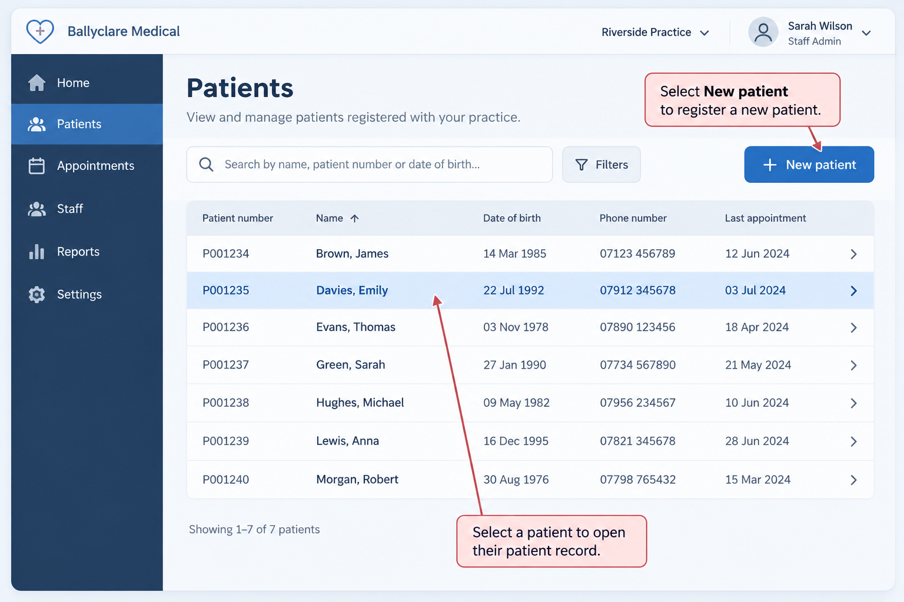
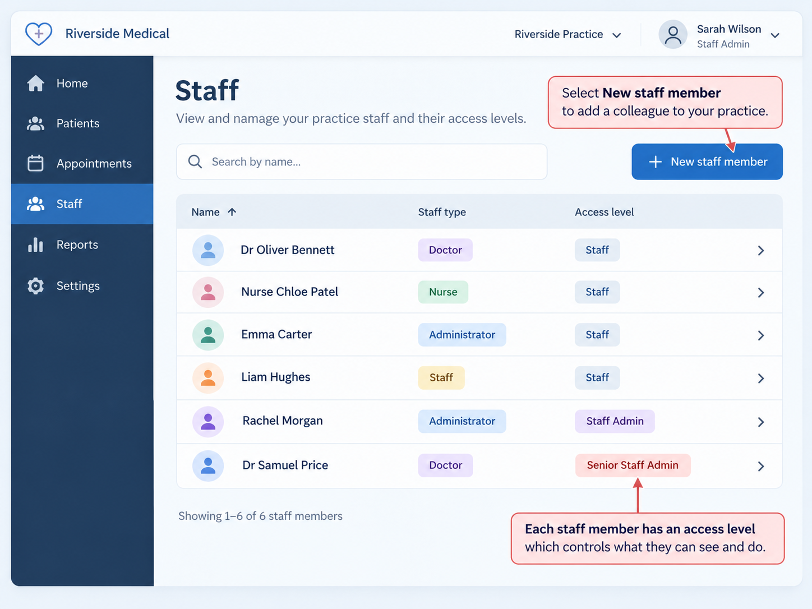
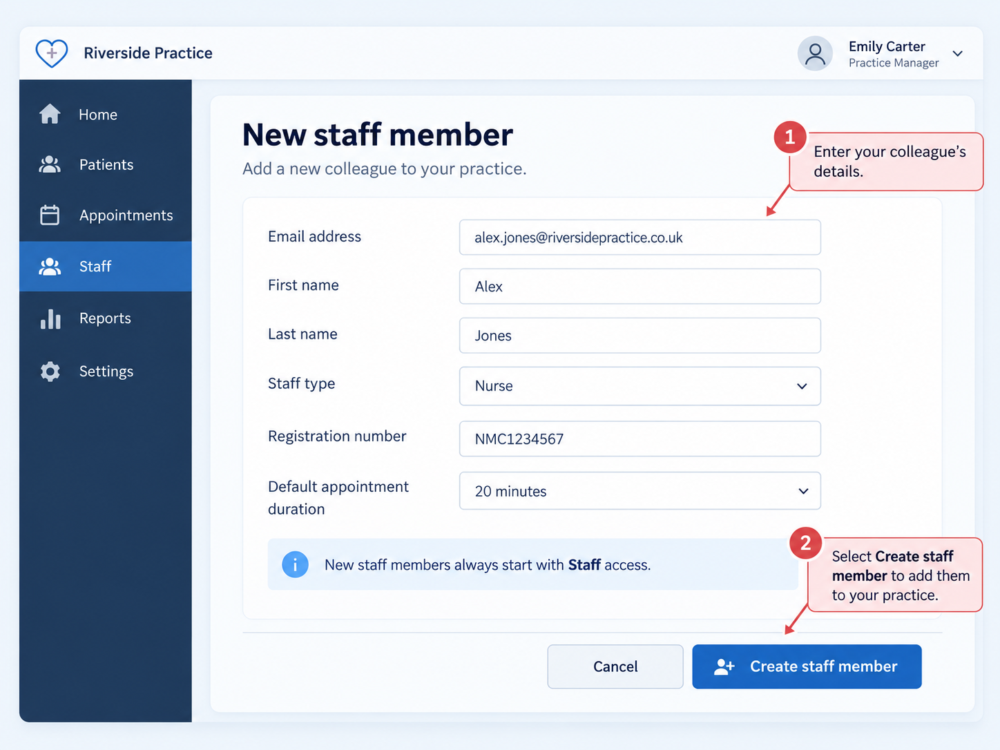
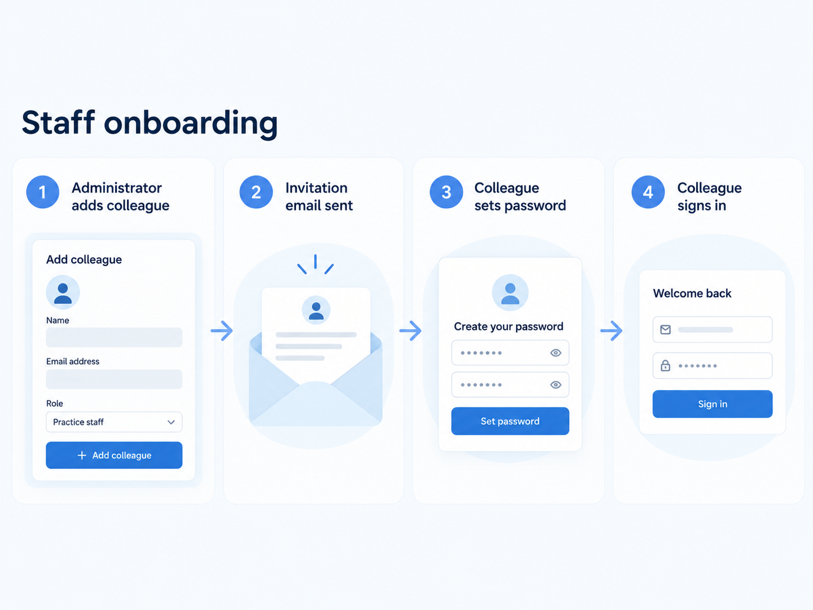

# Ballyclare Medical User Manual

This guide is intended for reception, administrative and clinical staff using
Ballyclare Medical. It is being expanded as new features become available.

## Contents

1. Getting Started
2. Signing In
3. Patients
4. Appointment Diary
5. Booking an Appointment
6. Cancelling an Appointment
7. Payments and Refunds
8. Clinician Availability
9. User and Staff Administration
10. Troubleshooting

## Getting Started

Ballyclare Medical supports day-to-day practice operations, including patients,
clinician availability, appointments and payments. Some clinical and
administrative features are still under development.

## Appointment Diary

The staff appointment diary lets staff view appointments and open an
appointment to review its status, financial summary and activity history.

## Booking an Appointment

Staff can book an available appointment for a patient, choose the clinician
and appointment slot, and enter a consultation charge. The appointment page
shows the recorded charge and any payments received.

For online bookings requiring payment, an appointment slot may be held
temporarily while payment is completed. An expired hold does not permanently
block the slot from being offered again.

## Cancelling an Appointment

Open the appointment and use the available status controls to cancel it.
Cancellation is blocked while a payment is pending or processing; wait for
the payment to reach a final state before trying again.

When cancellation succeeds, any active consultation charge is voided.
The original charge remains in the appointment's financial history.

If a successful payment has been collected, the system also requests a
refund for the amount not already covered by completed or in-progress
refunds. Staff do not need to initiate the standard cancellation refund
separately.

## Payments and Refunds

### Viewing payments and charges

The appointment page shows a financial summary with:

- **Charges** — total active charges, excluding voided charges.
- **Payments** — successful payments received.
- **Refunds** — refunds confirmed as successful.
- **Outstanding balance** — charges minus successful payments plus
  successful refunds.

A negative outstanding balance can appear temporarily after a paid
appointment is cancelled and its charge is voided, before the refund
has been confirmed. It should return to zero after a full refund succeeds.

Charges and refund records remain available for financial history and
audit purposes; voiding a charge does not delete it.

### Refund status messages

The appointment page may display one or more refund messages:

- **Refund pending** — the refund has been requested and is awaiting
  processing.
- **Refund processing** — the refund is being processed by Stripe.
- **Refund completed** — Stripe has confirmed the refund succeeded.
- **Refund failed** — the refund could not be completed and needs staff
  attention.

There may be more than one refund record for an appointment, such as
when a partial refund has already been made or an earlier refund attempt
failed. Read all status messages before taking further action.

### Automatic updates

While the staff appointment page is open, refund status messages and
the financial summary update automatically when the system receives
refund status changes. Staff normally do not need to refresh the page.

If the connection is interrupted or the page has been closed, reopening
or refreshing the appointment will display the latest recorded state.

### When a refund fails

A red **Refund failed** message indicates **Staff attention required**.
Review the appointment's payment and refund history and follow the
practice's escalation procedure. Do not assume the patient has been
refunded, and do not initiate a second refund without checking the
existing payment and refund records.

The staff interface currently shows refund status, but it does not
provide a manual refund initiation or retry control. Failed refunds
are not automatically retried.

### Online booking payment exceptions

If Stripe collects payment but an online appointment cannot be created
(for example, because its hold expired), the payment can be marked
`requires_refund`. Payment and refund history is retained separately
from appointment records in this case.

## Clinician Availability

Clinician availability determines which appointment slots may be booked.
Only available slots can be selected during staff appointment booking.

## User and Staff Administration

### Patient records

*Patients list: View patients registered with your practice, open an existing
patient record or begin a new registration.*

Staff can open **Patients** from the practice navigation to view patients
registered with their practice. Select **New patient** to register a patient,
entering a unique patient number, first name, last name and date of birth.
Select a patient from the list to view or edit their details. Patient records
from other practices are not available through these pages.

*New patient: Enter the patient number, first name, last name and date of
birth, then save the new patient record.*

### Staff directory and access levels

*Staff directory: View colleagues linked to your practice. Staff type describes
their responsibilities; access level determines their administrative permissions.*

The staff directory is currently available at `/practice/staff_members`.
It lists staff members associated with the signed-in user's practice.

A staff member's type (doctor, nurse or administrator) describes their
responsibilities. Their *access level* separately determines administrative
authority within that practice:

- **Staff** — the default level for every new staff membership.
- **Staff Clinician** — available to doctors and nurses. Additional access to
  medical records is planned but has not yet been enabled.
- **Staff Admin** — can add ordinary staff members to the practice.
- **Senior Staff Admin** — can change access levels
  for staff in their own practice.

Only Senior Staff Admins may change another staff member's access level.
To do so, open **Staff**, select **Edit access** beside a colleague, choose
the appropriate level and select **Save access level**. Select **Cancel**
to leave their access unchanged. Staff Clinician is available only for
colleagues whose staff type is Doctor or Nurse.

The server rejects requests from ordinary Staff and Staff Admin accounts,
as well as requests affecting staff in a different practice. Senior Staff
Admins cannot demote themselves. A staff member's access level in one
practice does not confer those permissions in another.

### Adding a staff member

*New staff member: Enter your colleague's email address and practice details,
then select Create staff member.*

Staff Admins and Senior Staff Admins can add colleagues to their practice.
Open the staff directory at `/practice/staff_members` and select
**New staff member**. Enter the colleague's email address, name, staff type
(doctor, nurse or administrator), and any applicable registration number
and appointment duration. Then select **Create staff member**.

New colleagues always start with **Staff** access. A Senior Staff Admin must
approve any subsequent change to their access level.

If the email address is new to Ballyclare Medical, the system creates an
account and sends password-setting instructions to that address. The
colleague follows the email link to choose a password before signing in.
If an account already exists, it is linked to the practice without changing
the person's existing password or sending another password-setting email.

*Staff onboarding: An administrator adds a colleague, the new colleague
receives password-setting instructions, chooses a password and signs in.
Existing account holders continue using their current password.*

If an error appears, correct the details and try again. An existing staff
member cannot be added to the same practice twice.

**Email availability:** Sending invitations requires the platform operator
to configure the application's outgoing email service. If an expected
message does not arrive, ask the platform operator to check email delivery;
do not share passwords or create a duplicate account.

### Setting up the first Senior Staff Admin

When a new practice is added, an authorised platform operator sets up its
first Senior Staff Admin. The practice should provide the intended
administrator's email address and confirm who is authorised to manage
staff access.

The initial setup is not yet available through the staff interface.
Contact the platform operator to arrange it; practice staff do not need
to use a terminal or Rails console. Once setup is complete, the
administrator can sign in using their own account.

A practice can only go through this initial setup before any staff
members have been registered. If the practice already has staff, contact
the platform operator rather than trying to repeat the setup.

The initial Senior Staff Admin setup is a separate operator process; the
ordinary staff invitation form cannot grant senior permissions.
Never share passwords or use a shared administrator login.

### Recovering administrative access

If a practice has existing staff but no accessible Senior Staff Admin,
**do not rerun bootstrap or create a substitute privileged account using
seed data**. Escalate to an authorised platform operator to verify the
practice and account ownership before recovery. A dedicated, audited
recovery workflow has not yet been implemented.

Protection against losing the last active Senior Staff Admin during
deactivation or removal is also planned before those actions are available.

## Troubleshooting

If an appointment's refund does not update immediately, check the
current refund status and allow time for Stripe processing. Refresh the
appointment page if the live connection has been interrupted.

For a failed refund, follow the escalation guidance above rather than
repeatedly attempting payment or cancellation actions.
